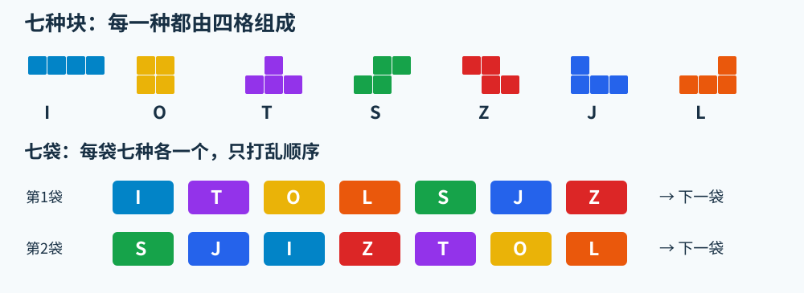
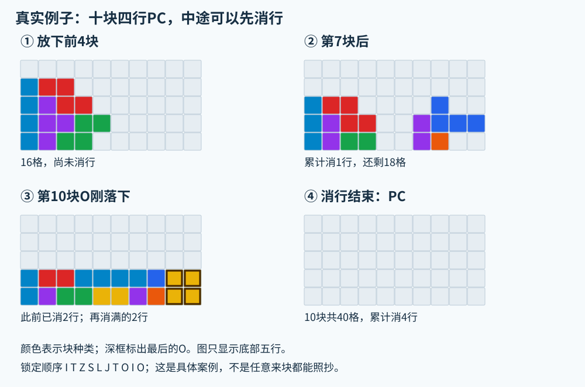
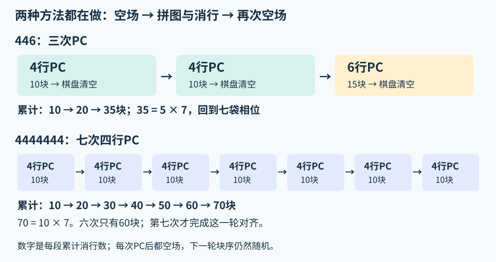

# 零基础看懂连续全清：446 与 4444444

没玩过现代俄罗斯方块也可以读这份说明。先记住一句话：**把方块拼成完整横行，消行后让棋盘一格不剩，再从空场开始下一段。**

这里把一个由四个小格组成的整体叫“一块”，单个小格叫“一格”，一组七种块叫“一袋”。这三个单位不能混着数。

## 1. 先认识棋盘和七种块

棋盘横向有 **10列**。方块从上方出现，你可以左右移动、旋转，然后让它落下。一个方块锁定后，就成为棋盘上固定的堆积。某一横行的10格全部填满，这一行会被消掉，上方的格子随之下移。

七种块都由 **4格** 组成，按外形分别叫 I、O、T、S、Z、J、L。颜色帮助辨认形状，颜色本身不影响规则。



现代块里有三个特别有用的功能：

| 功能 | 是什么 | 为什么对全清有用 |
|---|---|---|
| Next（预览） | 显示接下来若干块，本项目通常识别五个 | 可以提前考虑空隙留给哪种块 |
| Hold（暂存） | 把当前块放到一个暂存格，与里面的块交换；同一块锁定前通常只能换一次 | 把暂时不合适的块留到稍后用，但不是任意重排整个队列 |
| 软降／硬降 | 软降让块下降；硬降直接落到最下面并锁定 | 有时要先下降再旋入，不能提前硬降锁死 |

旋转遇到墙或堆积时，游戏还可能尝试小幅挪动，称为“踢墙”。本项目按TETR.IO的SRS+规则检查这些路线；**目标空隙形状装得下，不代表方块实际一定能移进去。**

## 2. 七袋：随机，但不是完全没有规律

TETR.IO常用 **7-bag（七袋）**：每袋都是I、O、T、S、Z、J、L各一个，把顺序打乱后发出，再打乱下一袋。

```text
第一袋：I T O L S J Z | 第二袋：S J I Z T O L | 第三袋：……
        七种各一个            七种各一个
```

这只是举例，不是必须使用的块序。同一袋里不会重复一种块；袋与袋交界却可以连续出现两个相同的块，例如第一袋以T结束、第二袋以T开始。

所以玩家能记住“这袋还没出现哪些块”。**如果袋边界已知，一袋已经出现六种，最后一种就能推出来；没有看见的顺序仍不能随便猜成事实。**

## 3. PC：消完后整盘空白

PC是Perfect Clear的简称，也叫All Clear、全清。它要求消行结束后，**整个棋盘没有任何已锁定格子**。

- 普通消行：清掉一行或几行，棋盘上还可能有别的格子。
- 消四／Tetris／Quad：一个方块落下时，同时清掉四行；上面仍有堆积的话，就不是PC。
- 四行PC：从上一次空场开始，累计消掉四行，最后再次空场。可以先消一行、再消一行、最后消两行，并不要求一次消四行。

下面来自本项目真实随机练习的前十块。它的锁定顺序是 `I T Z S L J T O I O`，通过Hold调整过顺序，所以不能把它当作原始发块顺序，更不能直接照搬到任何新局。



这里第7块时已经消掉1行，第9块后累计消掉2行，第10块O补齐最后2行。最终累计4行PC，**没有一次操作同时消四行**。完整逐块图解可在本地实验室的 `/pure4-manual` 查看。

## 4. 为什么四行PC恰好用十块？

从空场开始、无垃圾、也没有遗留格子时，格数必须守恒：

```text
放入的格子 = 消掉的格子
块数 × 4  = 行数 × 10

四行PC：4 × 10 ÷ 4 = 10块
六行PC：6 × 10 ÷ 4 = 15块
```

因此：4行不是4块，6行不是6块。“六行PC”也是累计消6行，常常分成几次完成。因为十列的一行有10格、每块有4格，从空场回到空场时累计消行数必须是偶数：2、4、6、8……都可能，单独累计1行或3行则不满足格数。

这一步只算得出“需要多少块”，**还没有证明这些具体形状、来块顺序和移动路线真能拼成。**

## 5. 446：三次全清，35块后接回七袋

446是 **4行PC → 4行PC → 6行PC** 的简称。每个数字表示两次空场之间累计消掉的行数。



先把Hold调序放到一边，按原始七袋的来源算账：

| 阶段 | 需要锁定 | 从连续七袋取块的基本分组 | 结束时 |
|---|---:|---|---|
| 第一次四行PC | 10块 | 第一袋7块＋第二袋3块 | 空场；第二袋还剩4块 |
| 第二次四行PC | 10块 | 第二袋剩余4块＋第三袋6块 | 空场；第三袋还剩1块 |
| 第三次六行PC | 15块 | 剩余1块＋第四袋7块＋第五袋7块 | 空场；本轮共用35块 |

```text
10 + 10 + 15 = 35块 = 5袋
 4 +  4 +  6 = 14行
```

第三段之所以特别适合DPC，是因为前两次PC之后只有一块旧袋余块。玩家按这块是O、I、S/Z等，选相应的搭建方法，再接两袋新块。常见DPC结构会先做 **T-spin Double（T块最后旋入、一次消两行，简称TSD）**，再收尾PC；这可以增加得分。[FOUR的DPC说明](https://four.lol/perfect-clears/dpc/)整理了按余块分支的结构。

**不是每次累计六行全清都天然就是一个已验证的DPC结构。** 这里把第三段简写为“6”，是为了数清一个446循环；具体DPC还需要搭对结构、选择正确的旋转和收尾。部分分支也会为了完成PC而放弃额外T-spin。

这一轮完成后，棋盘空了，袋的使用相位也对齐了，便具备开始下一轮的条件。下一轮各袋内部会重新随机，仍要重新判断。

## 6. 连续四行PC：为什么完整一轮是七次？

每次四行PC固定锁定10块，但每袋7块。做一次PC，会在袋相位上前进 `10 mod 7 = 3`。

| 第几次四行PC | 累计锁定块数 | 累计消行 | 块数除以7的余数 |
|---:|---:|---:|---:|
| 1 | 10 | 4 | 3 |
| 2 | 20 | 8 | 6 |
| 3 | 30 | 12 | 2 |
| 4 | 40 | 16 | 5 |
| 5 | 50 | 20 | 1 |
| 6 | 60 | 24 | 4 |
| **7** | **70** | **28** | **0** |

所以你写的“444444”可以表示已经连续做了六次四行PC，但它还没回到七袋相位。**这里讨论的完整循环是 `4444444`，七个4：70块＝10袋。** 这也是10和7的最小公倍数。[FOUR的第七次PC说明](https://four.lol/perfect-clears/7th/)直接介绍了这一对齐关系。

每次PC后棋盘虽然都空了，手头可用的块却不同。因此第1至第7次往往要学不同的起手和收尾，不能把第一套十块摆法机械重复七遍。

### Hold会不会把上面算乱？

Hold只改变哪些块先锁定，不凭空增加或减少格子，因此10块／15块的格数计算不变。但它会让“已发出的块”和“已锁定的块”不同：Hold里可能已经存着下一袋的一块，当前活动块也还没锁定。

表格先展示没有跨段调换时的基本账本。实际循环应把棋盘、Hold、当前块和队列的来源一起核对，才能确定库存与袋相位重新对齐；**单看计数器到了35或70，不能证明每一袋的来源都用对了。** 本项目专门记录来源并检查循环边界。

## 7. 真正把它拼出来，靠什么？

数学解决了“为什么这些段长能对齐”，实际摆放还要解决一个受来块顺序限制的拼图：

1. **看当前、Hold和Next。** 不知道未来顺序也能开始，但先只用真正知道的信息。
2. **挑适合这批块的骨架。** 常见方法先选四块搭出一个容易收尾的低地形，而不是随便堆完再赌最后一块。
3. **边落边更新预览。** 四行PC若已经放4块，还剩6块；此时当前块和五个Next通常提供了更多收尾信息，再结合Hold搜索可行顺序。是否能完整看见、能否取得正确的块，仍要逐次检查。
4. **检查收尾能不能执行。** 不能留下被封住的洞；需要旋入时要保留空间、按合法路线下降和旋转。
5. **PC之后换下一阶段的思路。** 446的第三段按余块选DPC，纯四行则继续推进第3至第7阶段。

程序的主要工作就是反复做这些判断。它能记地形、枚举分支和检查路线，但有限预览、搜索耗时与高重力依然会限制成功率。[Best Chance Field作者](https://knewjade.github.io/best-chance-field/)也明确说明，所列地形是作者已搜索范围中的较好选择，并非已证明的全局最优。

## 8. 两种循环怎么比较？

| 项目 | 446 | 七次纯四行PC |
|---|---|---|
| 一轮 | 4＋4＋6行 | 4×7＝28行 |
| 方块／七袋 | 35块／5袋 | 70块／10袋 |
| 一轮PC次数 | 3 | 7 |
| 同样70块的理想PC次数 | 6 | 7 |
| 主要思路 | 用六行DPC接回袋相位，可争取旋转收益 | 每段保持四行，按七种阶段调整结构 |

同样放70块并且每段都成功时，纯四行多一次PC；但这不代表实机总分一定更高。还要看哪种方法更容易完成、T-spin和消四收益、搜索及操作速度，以及Blitz升级后奖励的变化。

**本项目当前冲分默认是PC搜索＋失败时消行续打，不强制每局始终446或始终纯四行。** 最高2,788,043分的录像也不能当成无限不断链循环的证明。

## 9. 第一次练习，可以按这个顺序

先在无垃圾、低重力或零重力的CUSTOM里练，不必一开始就追Blitz速度。

1. 认出七种块，学会旋转、Hold和硬降，观察一袋内各块只出现一次。
2. 跟一份具体图解完成第一次四行PC，理解“中途可以先消行，最后整盘清空”。
3. 再练第二次PC，注意下一段会剩下什么旧袋块。
4. 选择继续练446的DPC分支，或纯四行第3至第7次的结构；每次都看自己的Next，案例按键不能通用于另一局。

只想先看懂：读到第6节即可。想手动跟做：在本地实验室打开 `/manual`（35块446）或 `/pure4-manual`（70块纯四行）的逐块图解。想看计分区别：继续读[理论分数与278万拆分](Blitz理论与278万拆分.md)。

本文图形由本项目绘制；十块棋盘示例来自[自己的70块练习记录](pure4-human-replay.json)，每一幅都对应原记录的真实棋盘。来源资料中的成功率有指定结构和规则条件，不代表任何新局都能照抄或无限循环。
